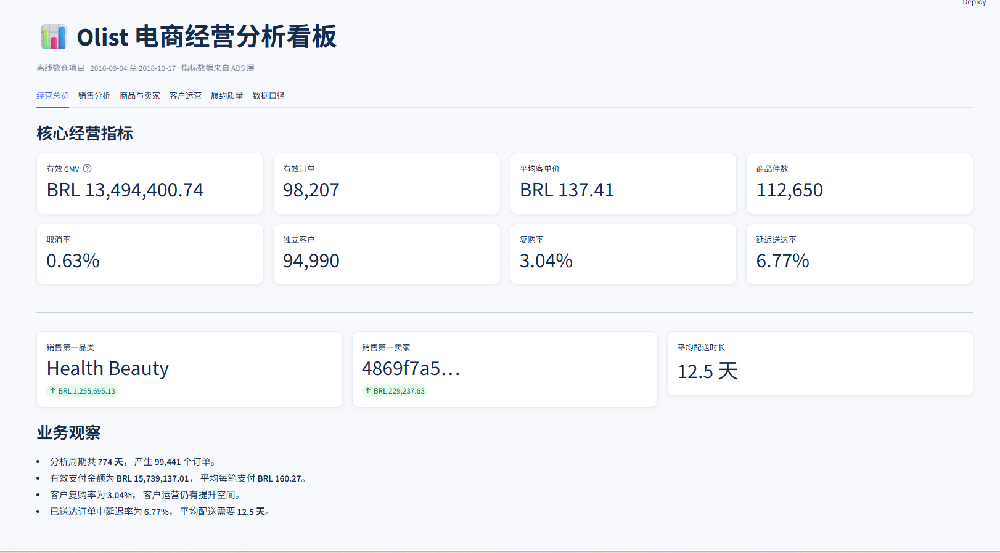
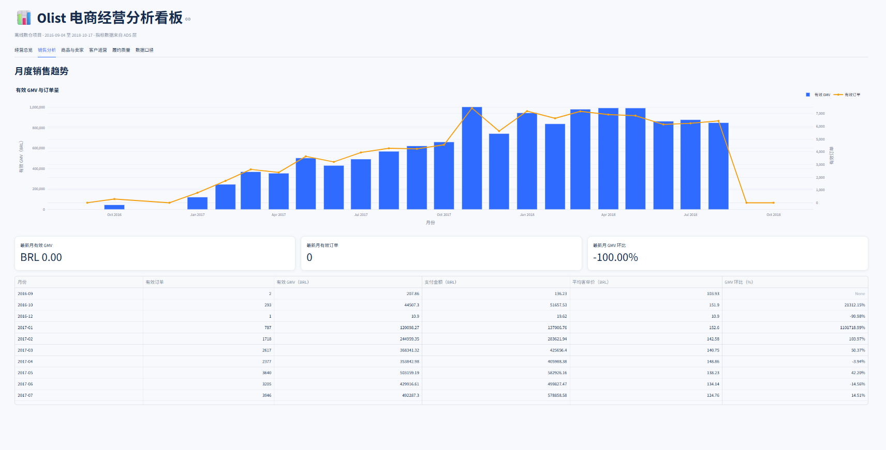
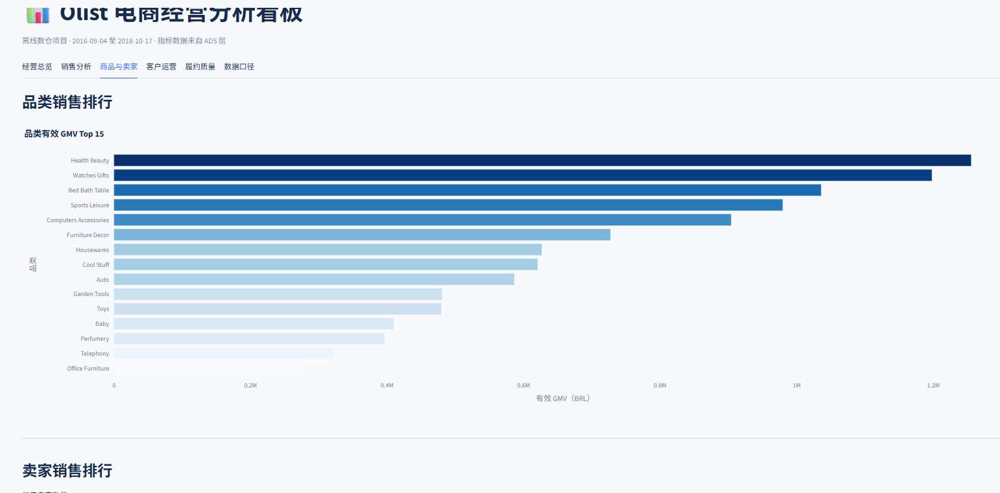
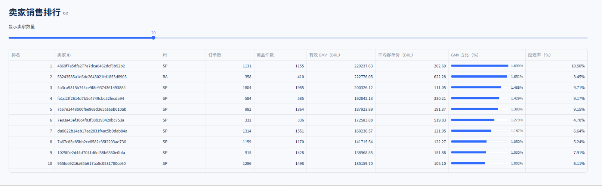
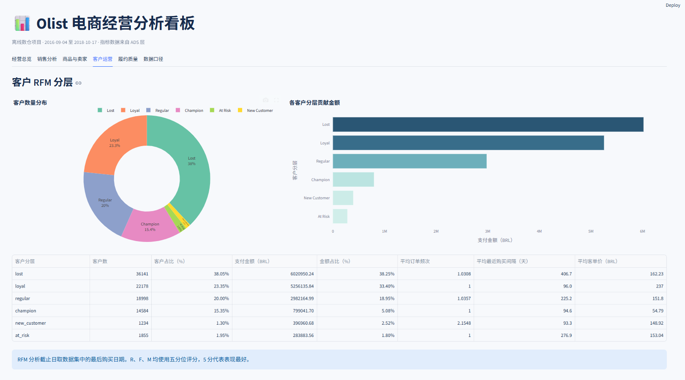
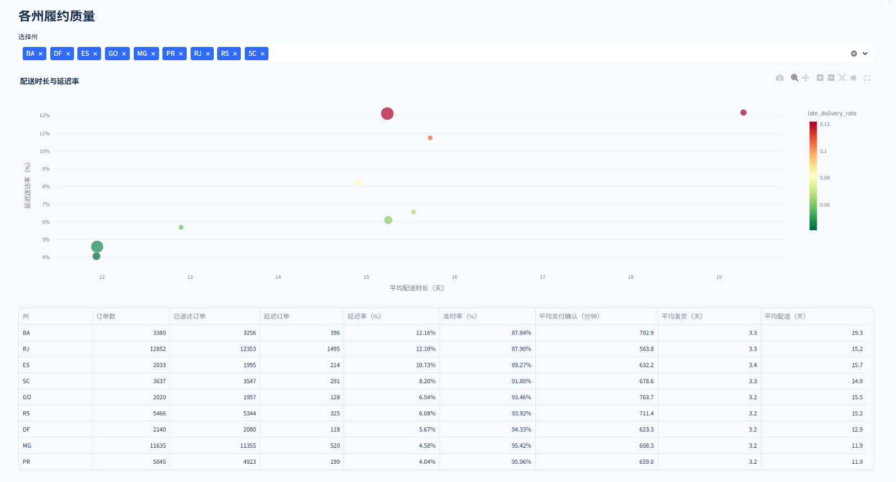
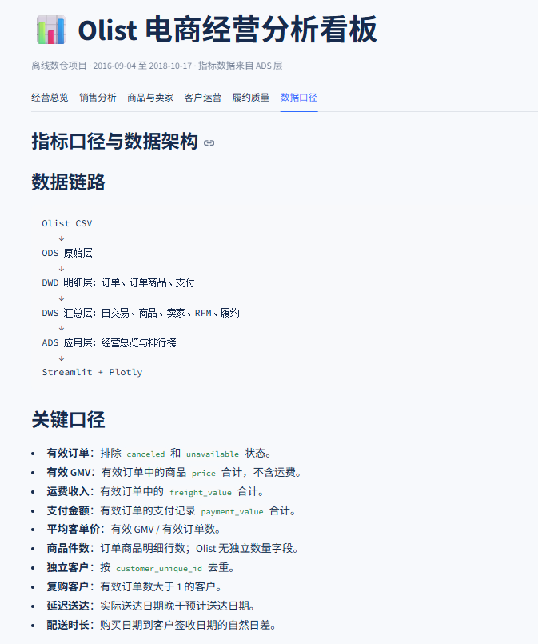
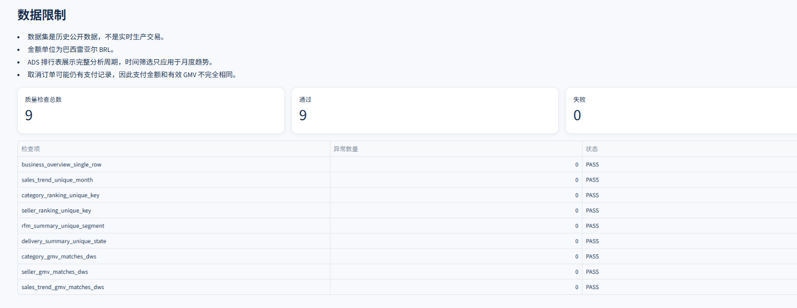

# Olist 电商离线数据仓库与经营分析看板

基于 Olist 巴西电商公开数据，使用 Spark SQL 构建
`ODS → DWD → DWS → ADS` 四层离线数据仓库，并通过
Streamlit + Plotly 完成交互式经营分析看板。

项目覆盖交易、商品、卖家、客户和履约五个分析主题，包含
维度建模、金额守恒、数据质量检查、客户 RFM 分层以及面向
BI 的 ADS 结果表。

## 项目亮点

- 使用 Spark SQL 完成四层数仓建模，避免跨层直接读取原始 CSV。
- 将订单、订单商品和支付拆成三个事实粒度，避免一对多关联导致
  GMV 和订单量重复计算。
- 实现客户 RFM 分层，并区分 `customer_id` 与
  `customer_unique_id`，确保复购统计基于真实客户。
- 对邮编地理数据按邮编前缀聚合，使用经纬度中位数消除一对多
  坐标记录。
- 建立 DWD、DWS、ADS 三阶段数据质量检查，共 25 项检查全部通过。
- 完成 Streamlit 交互式看板，包含 6 个分析页面和多张业务图表。

## 技术栈

| 类别 | 技术 |
|---|---|
| 计算引擎 | Apache Spark 3.5.9、PySpark、Spark SQL |
| 数据存储 | Parquet |
| 数据来源 | KaggleHub、Olist 公开数据集 |
| 数据处理 | Python、Pandas、PyArrow |
| 数据建模 | 星型模型、事实表、维度表、RFM |
| 可视化 | Streamlit 1.50、Plotly 7.1 |
| 开发环境 | Windows、Python 3.9、Java 8、PyCharm |

## 数据架构

```text
Olist CSV / KaggleHub
          │
          ▼
┌─────────────────────┐
│ ODS 原始数据层       │
│ 9 张原始业务表       │
└─────────────────────┘
          │
          ▼
┌─────────────────────┐
│ DWD 明细数据层       │
│ 5 张维度表           │
│ 3 张事实表           │
└─────────────────────┘
          │
          ▼
┌─────────────────────┐
│ DWS 汇总数据层       │
│ 交易、商品、卖家     │
│ 客户 RFM、履约       │
└─────────────────────┘
          │
          ▼
┌─────────────────────┐
│ ADS 应用数据层       │
│ 面向看板的汇总结果   │
└─────────────────────┘
          │
          ▼
┌─────────────────────┐
│ Streamlit + Plotly  │
└─────────────────────┘
```

## 数据源

数据来源为 Kaggle 公开数据集：

[Olist Brazilian E-Commerce Public Dataset](https://www.kaggle.com/datasets/olistbr/brazilian-ecommerce)

项目包含以下 9 个源文件：

| 源文件 | 用途 |
|---|---|
| `olist_orders_dataset.csv` | 订单状态和业务时间节点 |
| `olist_order_items_dataset.csv` | 商品、卖家、价格和运费 |
| `olist_order_payments_dataset.csv` | 支付方式和支付金额 |
| `olist_customers_dataset.csv` | 客户和地区信息 |
| `olist_products_dataset.csv` | 商品属性与品类 |
| `olist_sellers_dataset.csv` | 卖家地区信息 |
| `olist_geolocation_dataset.csv` | 邮编对应经纬度 |
| `olist_order_reviews_dataset.csv` | 订单评价 |
| `product_category_name_translation.csv` | 葡萄牙语品类翻译 |

数据为匿名的历史公开数据，金额单位为巴西雷亚尔 BRL。使用时应
遵守数据集页面标注的许可证，并在项目文档中保留来源说明。

## 数据仓库模型

### ODS 原始层

9 张业务表和附加采集字段统一写入 Parquet：

```text
data/ods/
├── olist_orders/
├── olist_order_items/
├── olist_payments/
├── olist_customers/
├── olist_products/
├── olist_sellers/
├── olist_geolocation/
├── olist_order_reviews/
└── olist_category_translation/
```

ODS 层保留原始字符串内容，并附加：

- `_source_file`：来源文件。
- `_ingest_time`：数据加载时间。

### DWD 明细层

| 表名 | 粒度 | 验证行数 |
|---|---|---:|
| `dim_date` | 每个自然日一行 | 800 |
| `dim_customer` | 每个 `customer_id` 一行 | 99,441 |
| `dim_product` | 每个商品一行 | 32,951 |
| `dim_seller` | 每个卖家一行 | 3,095 |
| `dim_geolocation` | 每个邮编前缀一行 | 19,015 |
| `fact_order` | 每个订单一行 | 99,441 |
| `fact_order_item` | 订单号 + 商品明细序号 | 112,650 |
| `fact_payment` | 订单号 + 支付序号 | 103,886 |

DWD 的关键处理：

- 将订单和物流时间字符串转换为时间戳。
- 将商品、支付和运费金额转换为 `decimal(18,2)`。
- 标准化邮编前缀、城市和州字段。
- 商品表关联品类英文翻译，缺失品类统一标记为 `unknown`。
- 地理坐标按邮编分组，使用经纬度中位数生成统一地理位置。
- 订单、商品明细和支付分别建模，避免事实表之间的多对多放大。
- 计算支付确认时长、发货时长、配送时长和延迟送达标记。

### DWS 汇总层

| 表名 | 粒度 | 用途 |
|---|---|---|
| `trade_day` | 每日一行 | 每日订单、GMV、支付和取消指标 |
| `product_day` | 日期 + 商品 | 商品和品类销售 |
| `seller_day` | 日期 + 卖家 | 卖家经营和延迟指标 |
| `customer_rfm` | 每个真实客户一行 | 首购、复购、R 分、F 分、M 分 |
| `delivery_day` | 日期 + 客户州 | 发货、配送和延迟履约 |

### ADS 应用层

| 表名 | 粒度 | 用途 |
|---|---|---|
| `business_overview` | 全周期一行 | 经营总览 KPI |
| `sales_trend` | 每月一行 | 月度 GMV、订单和环比 |
| `category_ranking` | 每个品类一行 | 品类销售排行 |
| `seller_ranking` | 每个卖家一行 | 卖家销售排行 |
| `rfm_summary` | 每个 RFM 分层一行 | 客户分层汇总 |
| `delivery_summary` | 每个州一行 | 履约质量汇总 |

## 关键指标口径

| 指标 | 定义 |
|---|---|
| 有效订单 | 排除 `canceled` 和 `unavailable` 状态的订单 |
| 有效 GMV | 有效订单中商品 `price` 的合计，不含运费 |
| 运费收入 | 有效订单中 `freight_value` 的合计 |
| 支付金额 | 有效订单中 `payment_value` 的合计 |
| 平均客单价 | 有效 GMV / 有效订单数 |
| 商品件数 | 订单商品明细行数；源数据没有独立数量字段 |
| 独立客户 | 按 `customer_unique_id` 去重后的客户数 |
| 复购客户 | 有效订单数大于 1 的客户 |
| 复购率 | 复购客户数 / 独立客户数 |
| 延迟送达 | 实际送达日期晚于预计送达日期 |
| 配送时长 | 下单日期到客户签收日期的自然日差 |

注意：Olist 的 `customer_id` 更接近单次下单标识，真正的客户标识
是 `customer_unique_id`。复购和 RFM 必须使用后者。

## 数据质量

项目按层执行质量检查，并将结果写入 Parquet：

```text
data/dwd/_quality_checks
data/dws/_quality_checks
data/ads/_quality_checks
```

### DWD 检查

- 订单事实主键唯一。
- 订单商品事实联合主键唯一。
- 支付事实联合主键唯一。
- 有效订单均可关联客户维度。
- 商品金额不存在负数。
- 订单购买时间不存在空值。

### DWS 检查

- 日期、商品、卖家、客户和履约汇总键唯一。
- 交易汇总订单数等于 DWD 订单数。
- 商品和卖家维度 GMV 等于事实层有效 GMV。
- 商品件数与事实明细一致。
- RFM 客户数与有效客户数一致。

### ADS 检查

- 经营总览只有一行。
- 月度、品类、卖家、RFM 和州汇总键唯一。
- 品类、卖家、月度趋势 GMV 均等于 DWS GMV。

当前质量结果：

```text
DWD：6 项检查全部通过
DWS：10 项检查全部通过
ADS：9 项检查全部通过
```

## 验证结果

### 金额守恒

```text
订单事实有效商品 GMV：13,494,400.74 BRL
商品维度汇总 GMV：   13,494,400.74 BRL
卖家维度汇总 GMV：   13,494,400.74 BRL
```

### 经营指标

| 指标 | 结果 |
|---|---:|
| 分析区间 | 2016-09-04 至 2018-10-17 |
| 订单总数 | 99,441 |
| 有效订单数 | 98,207 |
| 取消订单数 | 625 |
| 取消率 | 0.6285% |
| 有效商品 GMV | 13,494,400.74 BRL |
| 有效运费收入 | 2,241,126.29 BRL |
| 有效支付金额 | 15,739,137.01 BRL |
| 商品件数 | 112,650 |
| 平均客单价 | 137.41 BRL |
| 独立客户数 | 94,990 |
| 复购客户数 | 2,888 |
| 复购率 | 3.0403% |
| 已送达订单数 | 96,476 |
| 延迟订单数 | 6,535 |
| 延迟送达率 | 6.7737% |
| 平均配送时长 | 12.50 天 |

### 业务结果

- 销售第一品类：`health_beauty`，GMV 1,255,695.13 BRL。
- 销售第一卖家：`4869f7a5dfa277a7dca6462dcf3b52b2`，
  GMV 229,237.63 BRL。
- 客户复购率较低，说明存量客户的二次转化是潜在运营方向。
- 交付延迟主要集中出现在长距离州和配送链路较慢地区。

## 看板展示

### 经营总览



### 销售趋势



### 商品与卖家排行





### 客户 RFM 分层



### 履约质量



### 数据质量





## 项目目录

```text
PythonProject/
├── dashboard/
│   ├── app.py
│   └── README.md
├── data/
│   ├── ods/
│   ├── dwd/
│   ├── dws/
│   └── ads/
├── docs/
│   └── screenshots/
├── .hadoop/
│   └── bin/
├── .streamlit/
│   └── config.toml
├── spark_env.py
├── ingest_ods.py
├── check_ods.py
├── build_dwd.py
├── build_dws.py
├── build_ads.py
├── requirements-dashboard.txt
└── README.md
```

## 环境准备

### Python 依赖

当前 PyCharm 项目使用的虚拟环境为：

```text
D:\PythonProjects\PythonProject\.venv
```

安装主要依赖：

```powershell
& "D:\PythonProjects\PythonProject\.venv\Scripts\python.exe" `
  -m pip install `
  "pyspark==3.5.9" `
  "kagglehub==0.3.13" `
  "pandas==2.3.3" `
  "pyarrow==21.0.0" `
  "streamlit==1.50.0" `
  "plotly==7.1.0" `
  -i https://pypi.tuna.tsinghua.edu.cn/simple
```

### Windows Hadoop 运行时

PySpark 在 Windows 上写入 Parquet 需要：

```text
.hadoop/bin/winutils.exe
.hadoop/bin/hadoop.dll
```

`spark_env.py` 会在 Spark JVM 启动前设置：

```python
os.environ["HADOOP_HOME"] = str(HADOOP_HOME)
os.environ["JAVA_TOOL_OPTIONS"] = (
    f"-Djava.library.path={HADOOP_BIN}"
)
```

这样可以避免 JVM 优先加载 `C:\Windows\System32` 中不兼容的
Hadoop DLL。

## 运行项目

### 1. 生成 ODS

脚本会通过 KaggleHub 获取 Olist 数据，并写入 ODS Parquet：

```powershell
Set-Location "D:\pycharm\PythonProject"

& "D:\PythonProjects\PythonProject\.venv\Scripts\python.exe" `
  ".\ingest_ods.py"
```

### 2. 检查 ODS

```powershell
& "D:\PythonProjects\PythonProject\.venv\Scripts\python.exe" `
  ".\check_ods.py"
```

### 3. 构建 DWD

```powershell
& "D:\PythonProjects\PythonProject\.venv\Scripts\python.exe" `
  ".\build_dwd.py"
```

### 4. 构建 DWS

```powershell
& "D:\PythonProjects\PythonProject\.venv\Scripts\python.exe" `
  ".\build_dws.py"
```

### 5. 构建 ADS

```powershell
& "D:\PythonProjects\PythonProject\.venv\Scripts\python.exe" `
  ".\build_ads.py"
```

### 6. 启动看板

```powershell
& "D:\PythonProjects\PythonProject\.venv\Scripts\python.exe" `
  -m streamlit run ".\dashboard\app.py"
```

浏览器访问：

```text
http://localhost:8501
```

停止看板：

```text
Ctrl + C
```

## 关键设计说明

### 为什么拆分三个事实表

- `fact_order`：适合订单量、客单价、状态分布和履约分析。
- `fact_order_item`：适合商品、品类和卖家销售分析。
- `fact_payment`：适合支付方式和支付金额分析。

若将订单、商品明细和支付直接按 `order_id` 关联，一个订单的多个
商品和多条支付记录会产生笛卡尔放大，导致 GMV 被重复累计。

### 为什么使用 `customer_unique_id`

Olist 中的 `customer_id` 是下单关联标识，同一个真实客户多次下单
可能对应多个 `customer_id`。客户复购和 RFM 使用
`customer_unique_id`，才能避免把同一个人拆成多个客户。

### 为什么取消订单不计入有效 GMV

取消和不可用订单会计入订单总量，用于计算取消率，但不属于有效
成交。支付表和交易表保留这些记录，以便后续扩展退款分析。

### 为什么没有实现 SCD2

当前公开数据只提供订单和维度的最终快照，没有字段变更历史。
项目使用 Type 1 维度去重。生产环境中应根据更新时间或 CDC 数据
实现 SCD2 和订单状态流水。

## 当前限制

- 数据截止到 2018 年 10 月，不代表当前业务。
- 数据集没有下单后的完整状态流水，订单状态只保留最终值。
- 商品明细没有独立数量字段，一件商品明细按一件计算。
- 看板的时间筛选只作用于月度趋势，排行榜展示完整周期。
- 当前采用手动顺序执行脚本，尚未接入 DolphinScheduler/Airflow。
- 实时 Kafka/Flink/ClickHouse 链路属于后续实时数仓项目。

## 后续改进

- 接入 DolphinScheduler 或 Airflow，配置任务依赖、失败重试和补数。
- 将 ADS 结果同步到 MySQL、PostgreSQL 或 Doris。
- 增加 Power BI 或 Superset 展示版本。
- 基于 Olist 历史时间字段构建 Kafka 实时事件流。
- 使用 Flink 实现实时 GMV、支付确认、超时订单和延迟预警。
- 增加实时与离线结果一致性核对。

## 面试可讲内容

1. 为什么采用四层数仓，DWD 和 DWS 分别解决什么问题。
2. 为什么订单事实和商品事实使用不同粒度。
3. 多商品订单与多条支付关联时如何避免 GMV 重复。
4. 如何定义有效订单、有效 GMV 和取消率。
5. `customer_id` 与 `customer_unique_id` 的区别。
6. 地理表一对多记录如何聚合。
7. 数据质量检查如何保证重跑结果一致。
8. RFM 分层规则和客户运营解释。
9. Spark 在 Windows 下 Hadoop DLL 与 JVM 加载问题的处理。
10. 如何将相同指标迁移到 Flink 实时计算。

## 项目状态

```text
ODS 数据入湖         已完成
DWD 维度与事实建模   已完成
DWS 业务汇总         已完成
ADS 应用结果表       已完成
数据质量检查         已完成
Streamlit 看板       已完成
任务调度             待完成
实时数仓链路         待开始
```
