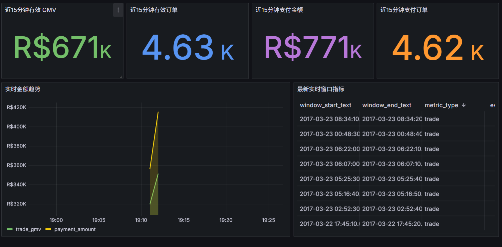
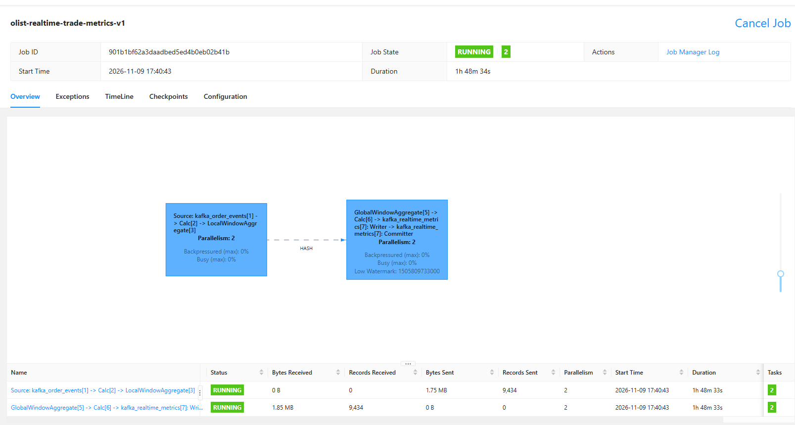
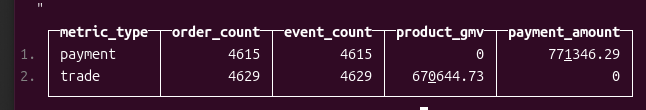
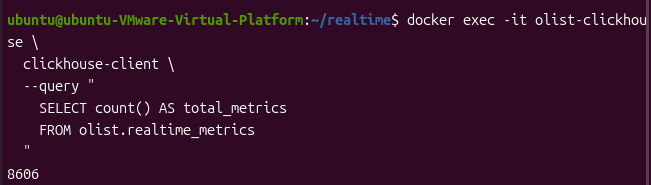

# Olist 实时数仓 Kafka 与 Flink 接入

该目录把 Olist DWD 历史订单回放为 Kafka 事件流，由 Flink SQL
计算 10 秒事件时间窗口的订单与支付指标，再把结果写回 Kafka。

```text
Olist DWD Parquet
        ↓
event_generator.py
        ↓
Kafka: olist_order_events
        ↓
Flink SQL
        ↓
Kafka: olist_realtime_metrics
        ↓
metric_consumer.py
        ↓
clickhouse_sink.py
        ↓
ClickHouse
        ↓
Grafana
```

## 数据事件

- `ORDER_CREATED`：下单事件。
- `PAYMENT_APPROVED`：支付确认事件。
- `SHIPPED`：卖家交给承运商事件。
- `DELIVERED`：客户签收事件。
- `CANCELED`：取消事件。公开数据没有取消时间，事件时间按购买后 1
  分钟模拟，文档和面试中必须明确该限制。

## 目录

```text
realtime/
├── event_generator.py
├── metric_consumer.py
├── check_stack.py
├── clickhouse_sink.py
├── clickhouse/
│   └── init.sql
├── grafana/
│   ├── dashboards/
│   └── provisioning/
├── docker/
│   └── clickhouse-grafana-compose.yml
├── flink_jobs/
│   └── trade_metrics.sql
└── runtimes/
    ├── common.ps1
    ├── bootstrap.ps1
    ├── start_kafka.ps1
    ├── start_flink.ps1
    ├── submit_flink_job.ps1
    └── stop_all.ps1
```

## 1. 安装 Python 依赖

如果当前目录还不是项目中的 `realtime` 目录，先复制源码：

```powershell
powershell -ExecutionPolicy Bypass `
  -File ".\install_to_project.ps1"
```

然后进入项目 realtime 目录。

```powershell
Set-Location "D:\pycharm\PythonProject"

& "D:\PythonProjects\PythonProject\.venv\Scripts\python.exe" `
  -m pip install -r ".\realtime\requirements.txt" `
  -i https://pypi.tuna.tsinghua.edu.cn/simple
```

## 2. 下载并初始化本地运行时

```powershell
powershell -ExecutionPolicy Bypass `
  -File ".\realtime\runtimes\bootstrap.ps1"
```

脚本会下载：

- Temurin JDK 17。
- Kafka 3.6.2。
- Flink 1.18.1。
- Flink Kafka SQL Connector 3.0.2-1.18。

二进制保存在 `realtime/.runtime/`，不会提交到 Git。

## 3. 启动 Kafka 和 Flink

打开第一个 PowerShell 窗口：

```powershell
Set-Location "D:\pycharm\PythonProject"
powershell -ExecutionPolicy Bypass `
  -File ".\realtime\runtimes\start_kafka.ps1"
```

打开第二个 PowerShell 窗口：

```powershell
Set-Location "D:\pycharm\PythonProject"
powershell -ExecutionPolicy Bypass `
  -File ".\realtime\runtimes\start_flink.ps1"
```

Kafka 监听 `127.0.0.1:19092`，Flink Web UI 为
`http://127.0.0.1:18081`。

## 4. 提交 Flink SQL 作业

```powershell
powershell -ExecutionPolicy Bypass `
  -File ".\realtime\runtimes\submit_flink_job.ps1"
```

SQL 作业将创建：

- `olist_order_events`：输入事件主题。
- `olist_realtime_metrics`：输出指标主题。

## 5. 启动指标消费者

```powershell
& "D:\PythonProjects\PythonProject\.venv\Scripts\python.exe" `
  ".\realtime\metric_consumer.py"
```

## 6. 回放订单事件

先验证事件构建：

```powershell
& "D:\PythonProjects\PythonProject\.venv\Scripts\python.exe" `
  ".\realtime\event_generator.py" --limit 100 --dry-run
```

再写入 Kafka：

```powershell
& "D:\PythonProjects\PythonProject\.venv\Scripts\python.exe" `
  ".\realtime\event_generator.py" --limit 5000 --speed 100000
```

`--limit 0` 表示回放全部订单。`--speed` 越大，历史时间压缩越快。

## 7. 检查运行状态

```powershell
& "D:\PythonProjects\PythonProject\.venv\Scripts\python.exe" `
  ".\realtime\check_stack.py"
```

Flink 控制台应显示已运行作业。指标消费者应持续打印：

```text
[TRADE] ... orders=... GMV=...
[PAYMENT] ... paid_orders=... amount=...
```

回放固定订单数后，可执行实时与回放源数据对账：

```powershell
& "D:\PythonProjects\PythonProject\.venv\Scripts\python.exe" `
  ".\realtime\validate_realtime.py" --limit-orders 100
```

## 8. 停止服务

```powershell
powershell -ExecutionPolicy Bypass `
  -File ".\realtime\runtimes\stop_all.ps1"
```

日志位于 `realtime/logs/`。

## 9. ClickHouse 与 Grafana

ClickHouse 官方不提供 Windows Server 原生安装包。推荐在 Docker
Desktop/WSL 2、Linux 虚拟机或 Linux 服务器中运行 ClickHouse 与
Grafana。

当前没有 Docker/WSL 时，Kafka 与 Flink 仍可完成事件计算，ClickHouse
和 Grafana 配置也可以保留，但 ClickHouse 服务需要换到支持的运行环境。

有 Docker 后执行：

```powershell
Set-Location "D:\pycharm\PythonProject"

docker compose `
  -f ".\realtime\docker\clickhouse-grafana-compose.yml" `
  up -d
```

服务地址：

```text
ClickHouse HTTP：http://127.0.0.1:8123
Grafana：http://127.0.0.1:3000
Grafana 初始账号：admin / admin
```

启动 Kafka 指标写入 ClickHouse：

```powershell
& "D:\PythonProjects\PythonProject\.venv\Scripts\python.exe" `
  ".\realtime\clickhouse_sink.py" --init-schema
```

ClickHouse 表使用 `ReplacingMergeTree` 和窗口结束时间版本号，Kafka
重复消息最终会按相同窗口键合并。Grafana 查询使用 `FINAL` 获取稳定结果。

仪表面板包括：

- 近 15 分钟有效 GMV。
- 近 15 分钟有效订单数。
- 近 15 分钟支付金额。
- 近 15 分钟支付订单数。
- 近 30 分钟金额趋势。
- 最新实时窗口明细。

## 设计说明

- Kafka 按 `order_id` 分区，保证同一订单事件局部有序。
- Flink 使用事件时间、Watermark 和 10 秒滚动窗口。
- 输入使用 `latest-offset`，因此应先启动 Flink 作业，再回放事件。
- 当前输出使用 Kafka Sink 和 at-least-once 语义。
- 下一阶段将消费 `olist_realtime_metrics` 写入 ClickHouse，并接入 Grafana。

## 实时看板

### Grafana 实时经营看板



### Flink 实时作业



### ClickHouse 实时指标



### ClickHouse 指标总量

